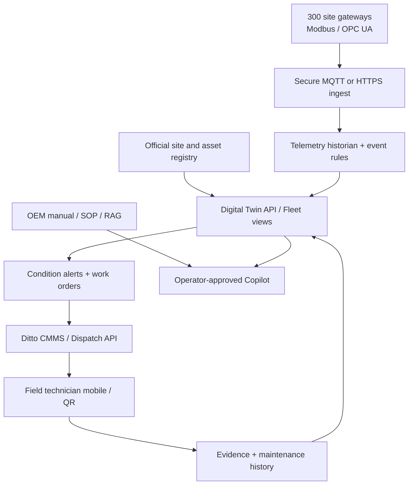

# RICE ATLAS — National Rice Digital Twin

Interactive proof of concept for **300 standardized rice seed-processing / biomass drying plants** across Thailand, with **Ditto (Thailand) nationwide maintenance orchestration**.

> **Important: This is a front-end prototype using synthetic data.** The 300 project records, plant health, sensor readings, map dots, service teams, alerts, and work orders are simulated. There is no IoT connection, OEM control, live dispatch, authenticated user management, or predictive AI model. Do not use simulated readings for machinery, procurement, safety, or maintenance decisions.

## Run

Requires Node.js 20+; **no package installation or credentials**.

```bash
npm start
# open http://localhost:4173
npm test
```

Or serve the project directory with any static web server. Uses a vendored MIT-licensed Three.js ES module for 3D; see `vendor/THREE-LICENSE.txt`. The app loads without third-party CDNs (external font CSS has system fallbacks).

## Screens

1. **National Command Center** — 300 demo sites across all 77 provinces; clickable schematic region hubs, synthetic condition status, priority queue, fleet KPIs and investment context.
2. **Standard Plant 3D Twin** — orbit/zoom/select 8 asset categories; illuminated process connections, asset inspector, condition indicators, simulated moisture/energy/biomass and process alerts.
3. **Ditto Maintenance Command Center** — nationwide regional dispatch concept; create, assign, progress and close **demo** work orders. Cases persist only in the current browser's `localStorage`; can export to CSV. Not connected to Ditto systems.
4. **Fleet Intelligence** — asset CAPEX breakdown, country → region → site → asset → sensor data architecture, AI/copilot/field-service roadmap.
5. **OPS Copilot** — transparent, rule-based demo responses. Not connected to a large language model or OEM data.

### Plant model from supplied reference (15 × 10 m)

| # | Asset / BOQ | Cost (THB per site) |
|---|---|---:|
| 1 | Rice receiving hopper | 150,000 |
| 2 | Pre-cleaner + bucket elevator | 700,000 |
| 3 | Biomass seed dryer with online monitoring | 4,250,000 |
| 4 | 3 × 20-ton silos, conveyors/elevators | 2,700,000 |
| 5 | Seed grader, **1 tonne/hour as listed** | 850,000 |
| 6 | MDB machine control cabinet | 350,000 |
| 7 | 5–50 kg bagging station | 700,000 |
| 8 | Solar + inverter + dongle | 2,100,000 |
| | **Per-site total** | **11,800,000** |

At 300 identical installations, the simple cost multiplication is **THB 3.54 billion**. This is **not** a confirmed program budget: it assumes every site has the same BOQ and excludes any costs not listed in the supplied screenshot.

Reference images: `assets/plant-reference.jpg` and `assets/equipment-budget.jpg` (supplied by project requester). The 3D assembly is conceptual—not a measured BIM/CAD/as-built model—and may differ in actual dimensions, capacities, and routing.

**Distribution note:** 300 projects across 77 provinces averages **3.90 plants per province**. The demo assigns 3–4 to each province to get exactly 300. The user's “4–5 per province” is an approximate planning description; actual allocation must come from the official site master list.

## Mathematical model (demonstration)

The scenario engine calculates a **wet-basis** mass balance:

```text
Dry solids = incoming_t/h × (1 − inlet_moisture_fraction)
Outgoing_t/h = dry_solids / (1 − target_moisture_fraction)
Evaporated_kg/h = (incoming_t/h − outgoing_t/h) × 1000

Thermal kW = evaporated_kg/h × 2.8 MJ/kg ÷ 3.6
Biomass kg/h = evaporated_kg/h × 2.8 MJ/kg ÷ (14 MJ/kg × 0.55)
PV kW = hypothetical_60_kWp × sunlight_factor × 0.82
```

All efficiency, heating value, electrical-demand and **60-kWp** assumptions are tunable prototype parameters, **not manufacturer specifications**. The supplied BOQ states only Solar + Inverter and gives no installed capacity. The demo's grain feed slider is **not** a claimed production rating, especially as the supplied grader is rated at 1 t/h; full line balancing must be verified.

## Target architecture for real 300-site rollout



Safeguards for production: authenticated tenant/site permissions; strong identity for engineers; TLS/device certificates; signed data from edge gateways; offline buffering; time sync; schema versioning; audit trail; user-visible freshness/quality flags; per-site RBAC and cross-company data agreements; read-only telemetry before considering remote control. **No direct PLC command path** in this prototype.

### Proposed commissioning sequence

**Phase 0 — Verified registry:** Site IDs/locations/provinces, equipment serials, OEM manuals, warranty, criticality, installer, actual solar kWp, P&IDs, approved maintenance service contracts and Ditto service zones/SLA.

**Phase 1 — 5–10-site pilot:** Gateway & historian, secure telemetry read-only, calibrated humidity/temperature/vibration/electrical monitoring, actual plant as-builts, alarm thresholds based on OEM, anomaly-to-ticket flow with human acknowledgment.

**Phase 2 — Ditto nationwide operations:** Field app with QR asset identification, skills/territory matching, parts catalog and stock, service schedules, SLA clock, photo evidence, customer sign-off, CMMS/ERP integration, fleet benchmarking.

**Phase 3 — Decision intelligence:** Predictive maintenance on verified failure history; forecast downtime, parts and maintenance demand; energy optimization with measured biomass and PV; human-approved SOP assistant with citations; no autonomous control without a separate safety design and approval.

### Minimum real-data contracts

| Data entity | Required examples | Owner to confirm |
|---|---|---|
| `sites` | `site_id`, province, lat/lon, installation date, project owner, timezone | Project owner / Department of Rice |
| `assets` | `site_id`, `asset_id`, model, serial, commissioning date, capacity, OEM manual, warranty | Supplier / installer |
| `sensor_points` | `asset_id`, tag, unit, calibration, limits, sample rate, quality flag | Controls/engineering team |
| `telemetry` | timestamp UTC, `site_id`, tag, value, quality and gateway status | Edge/SCADA supplier |
| `service_teams` | real team IDs, geographic coverage, skills, hours, escalation and SLA | Ditto Thailand |
| `work_orders` | asset/site, severity, diagnosis, assigned technician, timestamps, parts, labor, evidence, sign-off | Ditto / system owner |

The prototype is intentionally deployment-neutral (GitHub Pages, Netlify, internal web host, etc.). No production deployment is included.

## Repository structure

```text
index.html             All interface sections and accessible controls
styles.css             Responsive operations-console visual language
src/model.mjs          77 provinces, 300 demo sites, BOQ, drying model, maintenance workflow
src/scene.js           Interactive Three.js conceptual 3D factory
src/app.js             Site navigation, map, simulator, local demo work orders
tests/model.test.mjs   Pure model + workflow regression tests
vendor/               Bundled Three.js (MIT)
assets/               Provided plant reference and cost screenshots
server.mjs             Minimal Node static file server
```

**Project status:** Functional visual and workflow prototype. No production telemetry or live Ditto integration yet.
